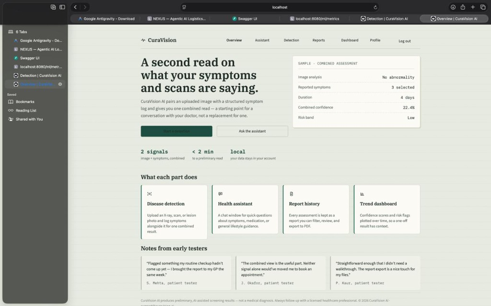
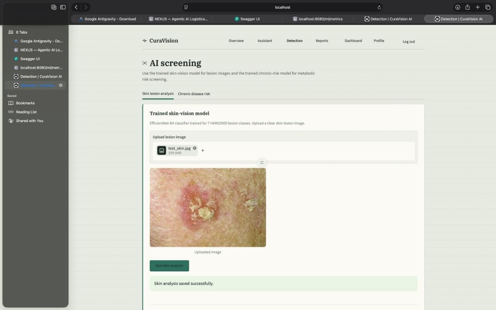
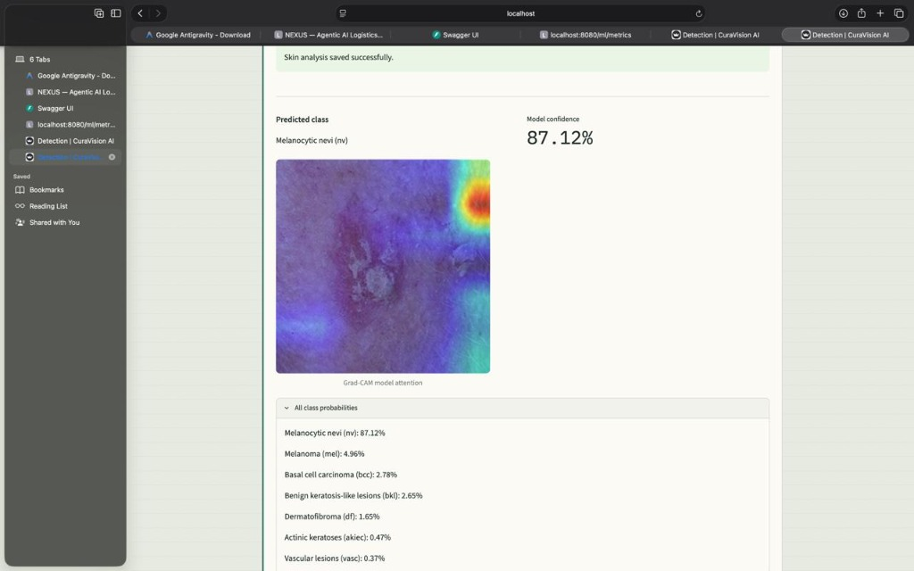
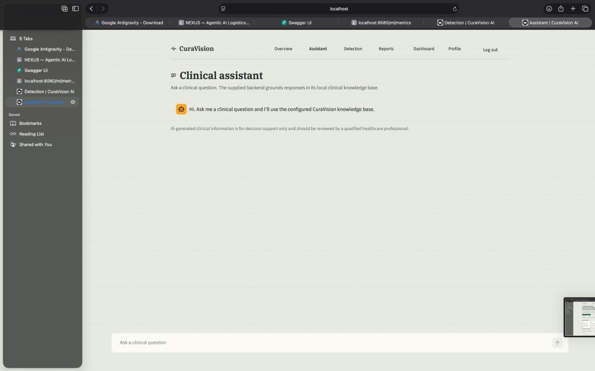
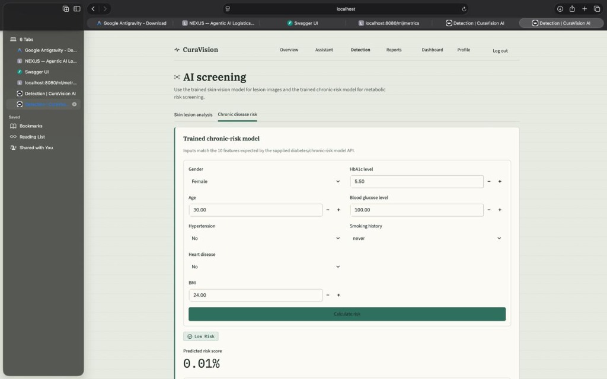
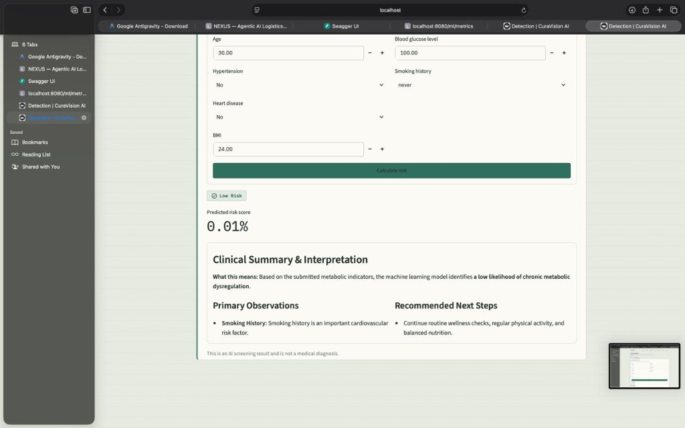
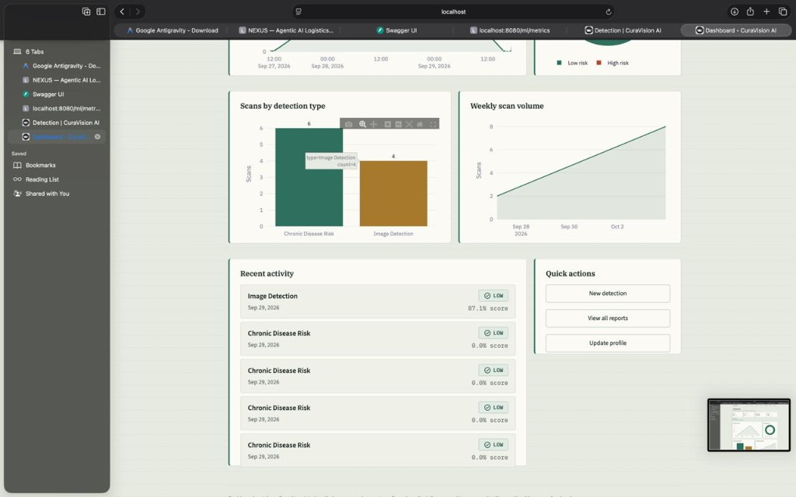
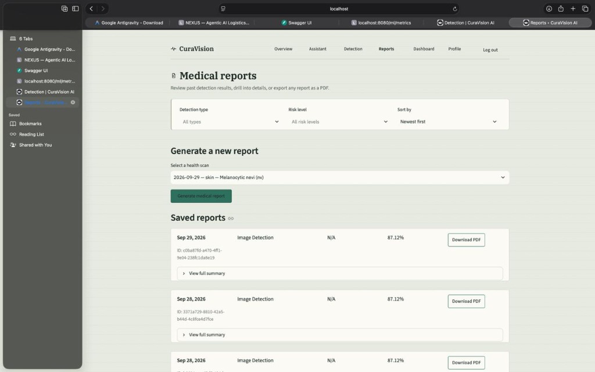
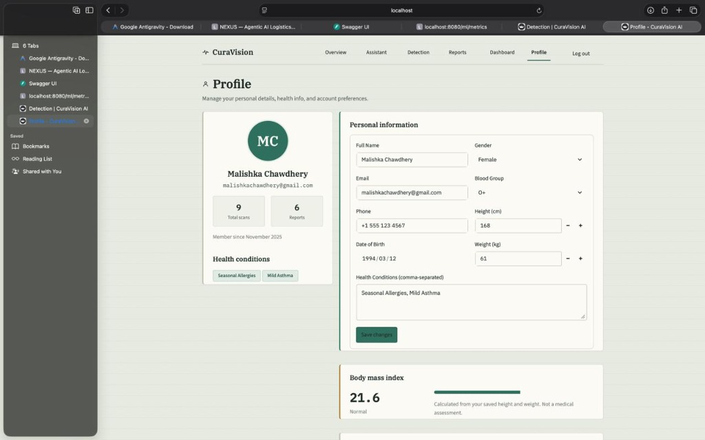

<div align="center">


# 🩺 CuraVision AI

### AI-assisted health screening — skin lesion detection, chronic-disease risk prediction & clinical RAG assistant

[](https://python.org)
[](https://fastapi.tiangolo.com)
[](https://streamlit.io)
[](https://pytorch.org)
[](https://ollama.com)
[](https://supabase.com)
[](LICENSE)

> ⚠️ **Disclaimer:** CuraVision AI is an educational AI screening tool. It does **not** replace examination, diagnosis, or treatment by a qualified healthcare professional.

</div>

---

## 📸 Screenshots

<table>
  <tr>
    <td align="center" width="50%">
      
      <br/>
      <b>🏠 Overview — Home Page</b>
      <br/>
      <sub>Landing dashboard with combined assessment panel and feature overview</sub>
    </td>
    <td align="center" width="50%">
      
      <br/>
      <b>🔬 AI Screening — Detection Page</b>
      <br/>
      <sub>Upload a skin-lesion image and run EfficientNet-B4 analysis</sub>
    </td>
  </tr>
  <tr>
    <td align="center" width="50%">
      
      <br/>
      <b>🧠 Grad-CAM Explainability</b>
      <br/>
      <sub>87.12% confidence — Melanocytic nevi (nv) with heatmap overlay</sub>
    </td>
    <td align="center" width="50%">
      
      <br/>
      <b>💬 Clinical Assistant — RAG Chat</b>
      <br/>
      <sub>Grounded Q&A powered by ChromaDB + Llama 3.2 knowledge base</sub>
    </td>
  </tr>
  <tr>
    <td align="center" width="50%">
      
      <br/>
      <b>📊 AI Screening — Chronic Disease Risk</b>
      <br/>
      <sub>Enter vitals & lab values to predict diabetes risk using the trained ML model</sub>
    </td>
    <td align="center" width="50%">
      
      <br/>
      <b>✅ Risk Result & Clinical Summary</b>
      <br/>
      <sub>Low Risk (0.01%) with clinical interpretation, primary observations & next steps</sub>
    </td>
  </tr>
  <tr>
    <td align="center" width="50%">
      
      <br/>
      <b>📈 Dashboard — Scan Analytics</b>
      <br/>
      <sub>Scans by detection type, weekly scan volume, recent activity & quick actions</sub>
    </td>
    <td align="center" width="50%">
      
      <br/>
      <b>📋 Medical Reports</b>
      <br/>
      <sub>Review past detection results, filter by type & risk level, and export as PDF</sub>
    </td>
  </tr>
  <tr>
    <td align="center" width="100%" colspan="2">
      
      <br/>
      <b>👤 User Profile</b>
      <br/>
      <sub>Manage personal info, health conditions, BMI, and account preferences</sub>
    </td>
  </tr>
</table>

---

## ✨ What CuraVision AI Does

CuraVision brings **three AI capabilities** into one focused health workspace:

<table>
  <tr>
    <td>🔬 <b>Skin-Lesion Detection</b></td>
    <td>Upload a dermatology image → EfficientNet-B4 classifies across 7 HAM10000 categories → Grad-CAM heatmap highlights the region of interest</td>
  </tr>
  <tr>
    <td>📊 <b>Chronic-Disease Risk</b></td>
    <td>Enter vitals & lab values → scikit-learn model predicts diabetes risk → Llama 3.2 generates a patient-friendly explanation</td>
  </tr>
  <tr>
    <td>💬 <b>Clinical RAG Assistant</b></td>
    <td>Ask medical questions → Llama 3.2 answers strictly from a ChromaDB knowledge base of clinical guidelines & MT-Samples transcriptions</td>
  </tr>
</table>

---

## 🏗️ Architecture

```
┌─────────────────────────────────────────────────────────────────┐
│                        CuraVision AI                            │
├─────────────────┬───────────────────────────────────────────────┤
│  🖥️  Streamlit  │  app.py · pages/ · theme.py                  │
│     Frontend    │  Overview · Detection · Assistant             │
│                 │  Reports · Dashboard · Profile                │
├─────────────────┼───────────────────────────────────────────────┤
│  ⚡  FastAPI    │  /predict-risk                                 │
│     Backend     │  /clinical-rag-chat                           │
│                 │  /analyze/integrated-diagnosis                │
├────────┬────────┼───────────────────────────────────────────────┤
│  🧠    │  💬    │  EfficientNet-B4 (HAM10000, 7 classes)        │
│  CV    │  NLP   │  + Grad-CAM                                   │
│ Model  │  RAG   │  ChromaDB · nomic-embed-text · Llama 3.2      │
├────────┴────────┼───────────────────────────────────────────────┤
│  🗄️  Supabase  │  User Auth · Report Storage                   │
└─────────────────┴───────────────────────────────────────────────┘
```

---

## 🛠️ Tech Stack

| Layer | Technology |
|-------|-----------|
| **Frontend** | Streamlit, Plotly |
| **Backend API** | FastAPI, Pydantic, Uvicorn |
| **Computer Vision** | EfficientNet-B4 (timm), PyTorch, Grad-CAM |
| **NLP / LLM** | Llama 3.2:3b via Ollama, nomic-embed-text, ChromaDB, LangChain |
| **Data / ML** | scikit-learn, pandas, NumPy, joblib |
| **Auth & Storage** | Supabase |

---

## 🚀 Quick Start

### Prerequisites
- Python 3.11+
- [Ollama](https://ollama.com) installed and running
- A [Supabase](https://supabase.com) project

### 1. Clone the repo

```bash
git clone https://github.com/janvhi2308/Curavision-AI-
cd Curavision-AI-
```

### 2. Set up virtual environment

```bash
python -m venv venv
venv\Scripts\activate        # Windows
# source venv/bin/activate   # macOS/Linux
pip install -r "curavision-ai(2)/requirements.txt"
```

### 3. Configure Supabase secrets

Create the file `curavision-ai(2)/.streamlit/secrets.toml`:

```toml
SUPABASE_URL = "your-supabase-project-url"
SUPABASE_KEY = "your-supabase-anon-key"
```

### 4. Pull Ollama models

```bash
ollama pull llama3.2:3b
ollama pull nomic-embed-text
```

### 5. Build the ChromaDB knowledge base

```bash
python ingest.py
python ingest_mtsamples.py
```

### 6. Start the FastAPI backend

```bash
uvicorn main:app --reload --port 8000
```

### 7. Launch the Streamlit frontend

```bash
cd "curavision-ai(2)"
streamlit run app.py
```

Open **http://localhost:8501** in your browser 🎉

---

## 📁 Project Structure

```
Curavision-AI/
│
├── 🔧 Backend (Janhvi Chaurasia)
│   ├── main.py                        # FastAPI — 3 REST endpoints
│   └── curavision-ai(2)/backend.py    # HTTP client layer
│
├── 🧠 RAG / NLP (Khushi Burman)
│   ├── rag_chat.py                    # Standalone RAG runner
│   ├── ingest.py                      # Clinical guideline ingestion
│   ├── ingest_mtsamples.py            # MT-Samples ingestion
│   └── chroma_db/                     # Persisted vector database
│
├── 👁️  Computer Vision (Nehal Verma)
│   └── curavision-ai(2)/skin_model/
│       ├── inference.py               # EfficientNet-B4 + Grad-CAM
│       └── best_skin_model.pth        # Trained weights (HAM10000)
│
├── 🖥️  Frontend UI (Maahi Chaurasiya)
│   └── curavision-ai(2)/
│       ├── app.py                     # Landing page
│       ├── theme.py                   # Shared design system
│       └── pages/
│           ├── home.py                # Overview page
│           ├── dashboard.py           # Charts & trends
│           ├── disease_detection.py   # Detection UI
│           ├── assistant.py           # Chat interface
│           ├── reports.py             # Reports history
│           └── profile.py             # User profile
│
├── 🔐 Auth & Data (Janhvi + Malishka)
│   ├── curavision-ai(2)/supabase_client.py
│   ├── curavision-ai(2)/pages/login.py
│   ├── curavision-ai(2)/pages/signup.py
│   └── data/
│       ├── diabetes_prediction_dataset.csv
│       ├── cleaned_diabetes_data.csv
│       ├── diabetes_model.joblib
│       └── *.ipynb                    # Notebooks
│
└── ⚙️  DevOps & Testing (Malishka Chawdhery)
    ├── preprocessing.py               # Data cleaning pipeline
    ├── check_deps.py                  # Environment validator
    └── test_query.py                  # RAG pipeline tests
```

---

## 👥 Meet the Team

<table>
  <tr>
    <td align="center"><b>🖥️ Frontend</b></td>
    <td align="center"><b>⚡ Backend & API</b></td>
    <td align="center"><b>👁️ Computer Vision</b></td>
    <td align="center"><b>🧠 NLP & LLM</b></td>
    <td align="center"><b>⚙️ DevOps & Data</b></td>
  </tr>
  <tr>
    <td align="center">
      <b>Maahi Chaurasiya</b><br/>
      <a href="https://github.com/maahichaurasiya">@maahichaurasiya</a><br/>
      <sub>Streamlit UI, all pages, theme system, Plotly charts</sub>
    </td>
    <td align="center">
      <b>Janhvi Chaurasia</b><br/>
      <a href="https://github.com/janvhi2308">@janvhi2308</a><br/>
      <sub>FastAPI endpoints, Supabase auth, request validation</sub>
    </td>
    <td align="center">
      <b>Nehal Verma</b><br/>
      <a href="https://github.com/vermanehal">@vermanehal</a><br/>
      <sub>EfficientNet-B4 training, Grad-CAM explainability</sub>
    </td>
    <td align="center">
      <b>Khushi Burman</b><br/>
      <a href="https://github.com/khushiBurman">@khushiBurman</a><br/>
      <sub>RAG pipeline, ChromaDB, Llama 3.2 prompt design</sub>
    </td>
    <td align="center">
      <b>Malishka Chawdhery</b><br/>
      <a href="https://github.com/malishka491">@malishka491</a><br/>
      <sub>Data preprocessing, env setup, functional testing</sub>
    </td>
  </tr>
</table>

> See [CONTRIBUTORS.md](CONTRIBUTORS.md) for a full breakdown of each person's file ownership.

---

## 🧬 Model Details

### 🔬 Skin-Lesion Classifier (Nehal Verma)
- **Architecture:** EfficientNet-B4 (via `timm`)
- **Dataset:** HAM10000 — 10,000+ dermoscopy images
- **Classes:** 7 skin-lesion categories

| Code | Full Name |
|------|-----------|
| `akiec` | Actinic keratoses |
| `bcc` | Basal cell carcinoma |
| `bkl` | Benign keratosis-like lesions |
| `df` | Dermatofibroma |
| `mel` | Melanoma |
| `nv` | Melanocytic nevi |
| `vasc` | Vascular lesions |

- **Explainability:** Grad-CAM saliency overlay on the last spatial block before the projection head

### 🧠 Clinical RAG Pipeline (Khushi Burman)
- **LLM:** Llama 3.2:3b (local, via Ollama)
- **Embeddings:** `nomic-embed-text`
- **Vector store:** ChromaDB (persisted)
- **Sources:** Clinical guidelines + MT-Samples medical transcriptions
- **Guardrail:** Model answers strictly from retrieved context only

---

<div align="center">

**© 2026 CuraVision AI — Built with ❤️ by a team of five**

*AI-assisted screening · Not a substitute for professional medical advice*

</div>
